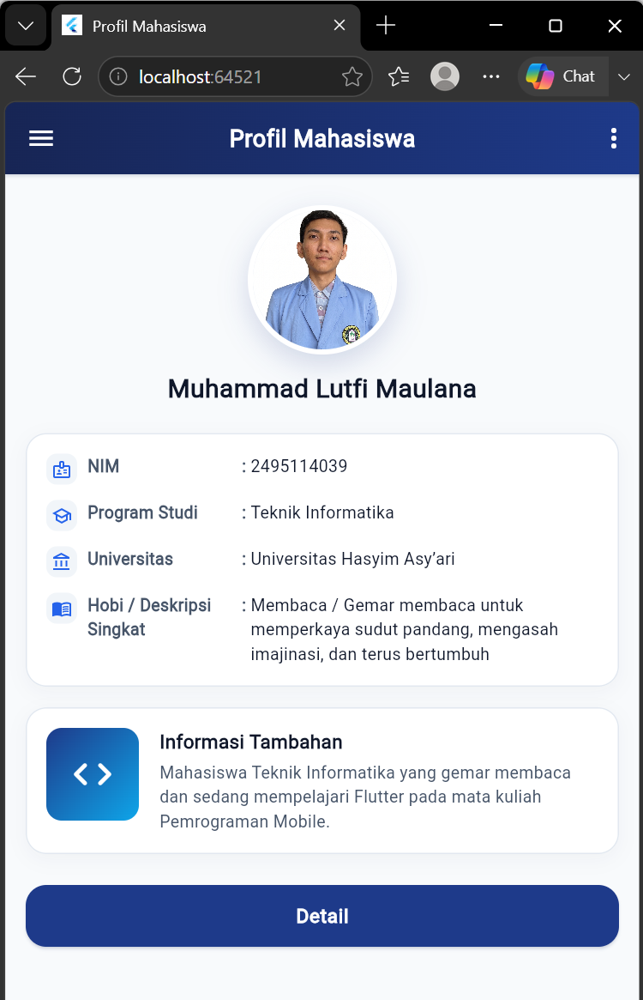

# Aplikasi Profil Mahasiswa

Aplikasi Flutter **Profil Mahasiswa** ini dibuat untuk memenuhi tugas **Lembar Kerja Praktikum (LKP) Mandiri: Widget dan Layout pada Flutter** (Mata Kuliah: Pemrograman Mobile).

Desain antarmuka aplikasi mengacu secara presisi pada **wireframe tugas mandiri**, dengan penerapan peningkatan estetika visual (kreativitas desain) yang konsisten, rapi, dan terstruktur tanpa mengubah urutan maupun struktur dasar elemen.

---

## A. Identitas Mahasiswa

- **Nama Mahasiswa** : Muhammad Lutfi Maulana
- **NIM** : 2495114039
- **Program Studi** : Teknik Informatika
- **Universitas** : Universitas Hasyim Asy’ari
- **Mata Kuliah** : Pemrograman Mobile
- **Pertemuan** : Pertemuan 7
- **Topik Praktikum** : Widget dan Layout Flutter
- **Link Repositori GitHub** : `https://github.com/[username]/profil_mahasiswa`

---

## B. Ringkasan Cara Menjalankan Aplikasi

Pastikan Flutter SDK sudah terpasang dan terkonfigurasi dengan baik di perangkat Anda.

1. **Masuk ke direktori project:**
   ```bash
   cd profil_mahasiswa
   ```

2. **Unduh dependensi (jika diperlukan):**
   ```bash
   flutter pub get
   ```

3. **Jalankan pengujian unit:**
   ```bash
   flutter test
   ```

4. **Jalankan aplikasi:**
   ```bash
   flutter run
   ```
   Atau jalankan pada target spesifik:
   - Melalui browser Chrome: `flutter run -d chrome`
   - Melalui Windows Desktop: `flutter run -d windows`

---

## C. Penjelasan Widget yang Digunakan

Berikut adalah penjelasan mengenai widget-widget yang digunakan dalam aplikasi sesuai dengan ketentuan wajib LKP dan rancangan antarmuka:

| No | Widget | Kategori | Fungsi & Penerapan dalam Aplikasi |
|---|---|---|---|
| 1 | **Scaffold** | Struktur Utama | Menyediakan kerangka dasar halaman antarmuka visual material design, mencakup properti `appBar` dan `body`. |
| 2 | **AppBar** | Navigasi / Header | Menampilkan bilah judul di bagian atas dengan teks *"Profil Mahasiswa"*, dilengkapi ikon menu (`Icons.menu`) di sebelah kiri, ikon opsi (`Icons.more_vert`) di sebelah kanan, serta dekorasi latar belakang gradasi warna. |
| 3 | **Column** | Layout Vertikal | Menyusun komponen utama secara vertikal dari atas ke bawah: foto profil, nama mahasiswa, kartu identitas, kartu informasi tambahan, dan tombol detail. Juga digunakan di dalam kartu identitas untuk menyusun 4 baris data identitas. |
| 4 | **Row** | Layout Horizontal | Menyusun elemen-elemen informasi secara horizontal: (1) pada baris identitas untuk menyejajarkan ikon, label, tanda titik dua (`:`), dan nilai; serta (2) pada kartu informasi tambahan untuk menyejajarkan gambar placeholder di sebelah kiri dan teks informasi di sebelah kanan. |
| 5 | **Container** | Styling & Dekorasi | Digunakan untuk mengatur margin, padding, dekorasi warna latar, border garis halus, radius sudut membulat, bayangan lembut (`boxShadow`), dan gradasi warna (`LinearGradient`) pada AppBar dan placeholder Informasi Tambahan. |
| 6 | **Card** | Widget Tambahan | Digunakan sebagai wadah kontainer untuk Kartu Identitas dan Kartu Informasi Tambahan (melalui fungsi helper `_buildCard`) dengan `margin: EdgeInsets.zero` agar tepinya sejajar presisi dengan tombol Detail. |
| 7 | **Icon** | Widget Tambahan | Menampilkan ikon visual bawaan Flutter (`Icons.menu`, `Icons.more_vert`, `Icons.person`, `Icons.badge_outlined`, `Icons.school_outlined`, `Icons.account_balance_outlined`, `Icons.menu_book_outlined`, dan `Icons.code_rounded`). |
| 8 | **ElevatedButton** | Widget Tambahan | Menampilkan tombol tindakan *"Detail"* di bagian paling bawah dengan latar belakang warna utama yang serasi, elevasi lembut, dan sudut membulat. Tombol tidak membuka halaman baru sesuai dengan batasan tugas LKP. |
| 9 | **CircleAvatar** | Tampilan Grafis | Menampilkan foto profil dalam bentuk lingkaran sempurna menggunakan gambar aset (`assets/foto_profil.dat`) via `backgroundImage: AssetImage(...)` dengan bingkai putih dan bayangan halus. |
| 10 | **SingleChildScrollView** | Responsivitas Layout | Membungkus seluruh konten body agar halaman dapat digulir (*scrollable*) secara mulus, mencegah potensi kendala *RenderFlex overflow* pada layar berukuran kecil. |
| 11 | **SafeArea** | Penanganan Layar | Memastikan tata letak aplikasi tidak terpotong oleh notch, status bar, maupun navigasi sistem operasi perangkat. |
| 12 | **Text** | Tipografi | Menampilkan teks judul, nama mahasiswa, label identitas, nilai identitas, judul kartu, serta teks deskripsi dengan hierarki gaya font yang jelas. |
| 13 | **SizedBox** | Pengatur Jarak & Dimensi | Memberikan jarak vertikal dan horizontal antar-elemen berdasarkan skala jarak teratur kelipatan 4 dan 8, serta menetapkan lebar tetap (120pt) pada kolom label agar tanda titik dua sejajar rapi. |

---

## D. Perbedaan dari Wireframe

> **Pernyataan Struktur:**  
> **Struktur dan urutan elemen tetap 100% sama dengan wireframe**, yaitu:  
> 1. AppBar berjudul "Profil Mahasiswa" dengan ikon menu di kiri dan ikon tiga titik di kanan.  
> 2. Foto profil berbentuk lingkaran.  
> 3. Teks "Nama Mahasiswa" di bawah foto.  
> 4. Kartu identitas berisi 4 baris berformat "label : nilai" (NIM, Program Studi, Universitas, Hobi / Deskripsi Singkat).  
> 5. Kartu "Informasi Tambahan" dengan gambar placeholder di kiri serta judul dan teks di kanan.  
> 6. Tombol "Detail" di bagian bawah.

Peningkatan visual yang diterapkan pada kode adalah sebagai berikut:

1. **Warna Tema & Identitas Visual:**
   - *Perubahan:* Wireframe awal menggunakan warna monokrom abu-abu polos. Pada kode diterapkan palet warna terkoordinasi: warna utama *Deep Indigo* (`#1E3A8A`), *Dark Navy* (`#172554`) untuk gradasi AppBar, aksen *Sky Cyan* (`#0EA5E9`), serta latar belakang netral lembut *Slate Light* (`#F8FAFC`).
   - *Alasan:* Menciptakan identitas visual yang profesional, bersih, dan konsisten di seluruh elemen (AppBar, kartu, ikon, dan tombol).

2. **Gradasi Halus pada AppBar:**
   - *Perubahan:* AppBar menggunakan dekorasi `LinearGradient` dari *Dark Navy* ke *Deep Indigo* (arah `topLeft` ke `bottomRight`).
   - *Alasan:* Memberikan estetika modern pada bagian header aplikasi serta menjaga kontras tinggi terhadap teks judul dan ikon navigasi berwarna putih.

3. **Ikon di Tiap Baris Identitas:**
   - *Perubahan:* Menambahkan ikon kecil seragam berukuran 16pt dengan warna konsisten (`AppColors.iconColor`) di sisi kiri setiap baris data identitas (`Icons.badge_outlined` untuk NIM, `Icons.school_outlined` untuk Program Studi, `Icons.account_balance_outlined` untuk Universitas, dan `Icons.menu_book_outlined` untuk Hobi).
   - *Alasan:* Memperjelas konteks informasi baris identitas secara visual tanpa mengubah format baris `"label : nilai"`.

4. **Bayangan Lembut (Soft Shadow):**
   - *Perubahan:* Menambahkan `BoxShadow` halus dengan opasitas rendah pada bingkai foto profil (`blurRadius: 18`) dan di dalam kartu (`blurRadius: 12`, `offset: Offset(0, 4)`).
   - *Alasan:* Memberikan efek kedalaman (*elevation*) yang elegan dan lembut tanpa bayangan yang kasar atau berlebihan.

5. **Sudut Membulat (Border Radius):**
   - *Perubahan:* Menerapkan radius sudut membulat yang konsisten: 16pt (`AppRadius.lg`) pada kartu dan tombol Detail, 12pt (`AppRadius.md`) pada kotak placeholder gambar, serta 8pt (`AppRadius.sm`) pada kontainer latar ikon baris identitas.
   - *Alasan:* Menjaga keseragaman geometri visual antarmuka sehingga seluruh komponen tampak selaras dan modern.

6. **Skala Jarak Teratur (Spacing):**
   - *Perubahan:* Menggunakan skala jarak berbasis kelipatan 4 dan 8 (`AppSpacing`), serta menetapkan lebar label identitas sebesar 120pt menggunakan `SizedBox`.
   - *Alasan:* Menjamin keteraturan margin/padding di seluruh halaman dan membuat posisi tanda titik dua (`:`) pada kartu identitas sejajar vertikal dengan rapi.

7. **Ikon Bergradasi pada Placeholder Informasi Tambahan:**
   - *Perubahan:* Kotak placeholder 72x72 di sebelah kiri kartu Informasi Tambahan menggunakan dekorasi `LinearGradient` dari `AppColors.primary` ke `AppColors.secondary` dengan sudut membulat 12pt, dan diisi ikon `Icons.code_rounded` berukuran 36 berwarna putih.
   - *Alasan:* Merepresentasikan aspek teknologi dan pemrograman secara estetis dan mandiri tanpa memerlukan aset gambar eksternal dari internet.

8. **Foto Profil dengan Gambar Aset Asli:**
   - *Perubahan:* Wireframe awal menampilkan siluet ikon pengguna abu-abu polos. Pada implementasi, `CircleAvatar` menggunakan gambar profil asli mahasiswa melalui `backgroundImage: AssetImage('assets/foto_profil.dat')` yang terdaftar pada `pubspec.yaml`, dibingkai dengan border putih dan bayangan halus.
   - *Alasan:* Menghadirkan identitas visual mahasiswa secara nyata dan personal sesuai tujuan aplikasi profil, dengan tetap mempertahankan bentuk lingkaran sempurna sesuai spesifikasi wireframe.

---

## E. Screenshot Hasil Aplikasi

> *Berikut adalah tangkapan layar tampilan aplikasi Profil Mahasiswa:*



---

## F. Kesimpulan (Draf Pengerjaan Praktikum)

Berdasarkan hasil pengerjaan tugas mandiri pembuatan aplikasi "Profil Mahasiswa", dapat ditarik beberapa kesimpulan:

1. **Pemahaman Konsep Widget dan Layout pada Flutter:**
   - Flutter menyusun antarmuka menggunakan hierarki pohon widget (*Widget Tree*). Komponen layout seperti `Column` (susunan vertikal) dan `Row` (susunan horizontal) menjadi fondasi utama dalam merealisasikan rancangan wireframe menjadi antarmuka nyata.
   - Penggunaan fungsi terpusat seperti `_buildCard` berhasil menyederhanakan kode (*DRY - Don't Repeat Yourself*), memastikan kartu identitas dan kartu informasi tambahan memiliki konfigurasi margin, elevasi, dan bayangan yang sepenuhnya seragam.

2. **Penerapan Kreativitas Desain dan Konsistensi Visual:**
   - Kreativitas desain yang baik berfokus pada keteraturan sistem desain (warna tema terkoordinasi, skala jarak teratur, radius sudut konsisten, dan hierarki tipografi berjenjang), bukan penambahan elemen yang tidak perlu.
   - Pemusatan konstanta (`AppColors`, `AppSpacing`, `AppRadius`) membuat kode program mudah dibaca, dirawat, dan dikembangkan lebih lanjut.

3. **Kendala yang Ditemui dan Solusi Implementasi:**
   - *Penyelarasan Teks Titik Dua:* Perbedaan panjang teks label diatasi dengan membungkus label dalam `SizedBox(width: 120)`, sehingga seluruh tanda titik dua (`:`) sejajar rapi dan nilai identitas dapat menggunakan `Expanded` untuk menyesuaikan sisa ruang.
   - *Tepi Kartu dan Tombol Detail:* Kartu bawaan memiliki margin default yang dapat membuat lebarnya tidak sejajar dengan tombol. Solusinya adalah menetapkan `margin: EdgeInsets.zero` pada `Card`, sehingga sisi kiri dan kanan kartu sejajar lurus dengan tombol Detail.
   - *Responsivitas Layar:* Penggunaan `SingleChildScrollView` dan `SafeArea` mencegah potensi error *RenderFlex overflow* saat aplikasi dibuka pada perangkat dengan layar kecil atau orientasi landscape.
